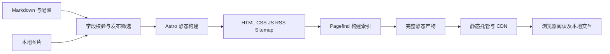

# Astro 个人博客技术方案 审阅稿

> 2026 年 10 月 29 日变更：友链功能已下架，导航和 `/friends/` 页面已移除。下文保留原审阅稿作为历史设计，当前功能以项目 README 和实际页面为准。

本方案用于审阅个人博客的功能范围与实现方式。目标是以 Astro 构建纯静态博客，围绕内容阅读与个人记录组织页面，使用本地内容文件维护文章、动态与友链，不接数据库，不部署业务后端。

已按最新要求排除文章评论和访问统计，包括评论区、评论反应数、PV、UV、文章阅读次数及相关第三方脚本。文章数、分类数、标签数由构建时计算，仍然保留。

状态：审阅稿。日期：2026 年 10 月 12 日。方案获确认后才进入代码实施；本次不创建博客应用、不部署站点。

## 1 结论与范围

推荐技术组合：**Astro 静态生成 + TypeScript + 原生 CSS 变量 + Markdown + Content Collections + Pagefind + Git 自动部署**。首版无需 Vue 或 React，也无需数据库、登录鉴权、业务 API 和在线管理后台。

静态并不意味着没有交互。搜索、深浅色切换、移动导航、代码复制、图片预览和页面过渡均在浏览器执行；文章与页面正文提前生成 HTML。读者访问网站不需要等待内容接口。

首版交付覆盖首页、文章详情、动态、友链、归档、分类、标签、关于，以及 RSS、站点地图、搜索、404 和移动端适配。动态维护和图片更新通过修改仓库文件后重新构建完成。

**功能范围以公开阅读体验为主。** 内容发布、删除和图片更新通过仓库文件管理，不提供依赖业务后端的在线管理功能，也不使用只保存在某台设备 localStorage 中的“假发布”。

个性化文案、头像、封面与收款码使用你提供的素材；正式上线前替换示例文章、作者介绍和友链配置。

## 2 功能规划与范围边界

本节定义博客的目标功能与实现边界。具体实现状态以项目源码、运行说明及验收结果为准，功能规划不等同于所有项目均已完成验收。

| 模块 | 目标能力 | 实现方式 |
| --- | --- | --- |
| 全局导航 | 博客、动态、友链、归档、关于及搜索入口 | 配置化导航，适配桌面与移动端 |
| 首屏横幅 | 图片背景与个人文案，首页与内页高度不同 | 本地素材；打字动画可选并允许关闭 |
| 侧栏 | 作者资料、社交链接、内容数量、公告、分类、标签、推荐文章 | 从配置及已发布内容生成 |
| 首页 | 文章卡片、标题、摘要、封面、日期、分类、标签和分页 | 构建时排序与静态分页 |
| 搜索 | 标题与正文搜索、高亮摘要、Ctrl/Cmd+K、Esc 关闭 | Pagefind 本地全文检索 |
| 主题 | 浅色、深色及跟随系统 | localStorage 保存界面偏好 |
| 页脚 | 版权、RSS、可选站点运行时长 | 不展示访问统计 |
| 推广位 | 可选静态图片与链接 | 默认关闭，不接广告网络 |
| 页面过渡 | 页面切换与浏览器历史导航 | Astro ClientRouter |
| 移动导航 | 抽屉、遮罩关闭、导航后关闭及键盘操作 | 浏览器端交互 |

| 页面 | 目标能力 | 范围边界 |
| --- | --- | --- |
| 文章详情 | 日期、字数、预计阅读时间、分类标签、Markdown、代码高亮与复制、锚点、目录和相邻文章 | 不提供评论、阅读量和点赞数 |
| 文章赞赏 | 可选二维码展示与切换 | 未配置时隐藏，不集成支付 API |
| 动态 | Markdown 短内容、多图、时间、静态分页和图片预览 | 本地文件维护，不提供在线发布或删除 |
| 友链 | 站点卡片、头像、简介、外链和交换信息 | 联系方式按配置显示，无虚构提交表单 |
| 归档 | 年份分组、文章数量、日期、标题和标签 | 仅使用已发布文章 |
| 分类与标签 | 汇总数量及文章时间线 | 与首页、侧栏使用同一内容集合 |
| 关于 | 自我介绍、技术栈、博客定位和联系方式 | 用实际资料替换示例内容 |
| 图片管理 | 本地存放图片并在内容文件中引用 | 不提供线上上传后台 |
| 开发待办 | 记录实施与验收事项 | 维护在项目文档，不发布独立页面 |

首页分页、文章目录、返回顶部和键盘操作纳入交互规划。照片墙、在线管理后台及额外内容增强不属于首版必需功能。

## 3 信息架构与路由

路由统一使用末尾斜杠，静态输出采用目录首页形式，避免直达深层 URL 依赖 SPA 重写。以下是拟定路由，不代表本轮已经创建文件。

| 路由 | 用途 | 内容来源 |
| --- | --- | --- |
| / | 博客首页，第 1 页 | 已发布文章 |
| /page/2/ | 首页第 2 页及后续页 | 构建时分页 |
| /posts/{slug}/ | 文章详情 | posts 集合 |
| /moments/ | 动态第 1 页 | moments 集合 |
| /moments/page/2/ | 动态后续页 | 构建时分页 |
| /friends/ | 友链与申请说明 | friends 数据和站点配置 |
| /archives/ | 全部文章时间线 | 已发布文章 |
| /categories/ | 分类索引 | 分类定义与文章聚合 |
| /categories/{slug}/ | 分类文章时间线 | 按分类筛选 |
| /tags/ | 标签索引 | 标签定义与文章聚合 |
| /tags/{slug}/ | 标签文章时间线 | 按标签筛选 |
| /about/ | 关于作者 | about Markdown |
| /rss.xml | 文章订阅 | 最新已发布文章 |
| /sitemap-index.xml | 搜索引擎索引入口 | 正式公开页面 |
| /robots.txt | 抓取规则 | 站点配置 |
| /404.html | 不存在的页面 | 独立错误页 |
| /pagefind/ | 搜索资源目录 | 构建产物，不是业务页面 |

首版不生成 /upload/、/todo/、/admin/ 或登录页。搜索以全局弹层提供，不生成不存在的 /search 链接或 SearchAction 元数据。

文章和分类、标签均使用稳定英文短链接，中文作为显示名称。显示名修改不改变 URL；slug 冲突使构建失败。首页第 1 页只使用 /，不重复生成 /page/1/。分类与标签详情首版不分页，以时间线完整列出；规模较大时可另加分页。

菜单顺序默认：博客、动态、友链、归档、关于。分类和标签从侧栏及内容元数据进入，移动端也必须有可达入口。

## 4 页面功能规格

### 4.1 全局布局

桌面采用顶部导航、图片横幅、左侧信息栏与右侧正文；首页使用较高横幅，内页缩短。采用圆角卡片、柔和边框、淡背景和清晰层级，颜色与素材通过站点配置管理。

建议设计值：内容最大宽度 1440px，侧栏约 260px，间距 24px；低于 1024px 改为单栏，低于 640px 使用紧凑导航与抽屉。实际卡片列数由可用内容宽度决定，避免在侧栏挤占宽度后强行放三列。验收覆盖 375、768、1024、1440px。

侧栏依次为作者卡、公告、分类、标签、推荐文章。移动端保留紧凑作者信息，其余模块折叠或移到正文后。推荐文章按显式推荐顺序选取，缺额用最新文章补足至 6 篇；不得显示“热门”或伪造热度。

横幅打字机从配置数组读取，避免定时器重复注册。减少动态效果偏好开启时直接展示完整静态句子。页脚显示版权、RSS、可选站点运行天数；运行时长由配置的建站日期计算，与访客行为无关。

### 4.2 首页与文章卡片

默认每页 9 篇，先按置顶权重降序，再按发布日期降序，同一时间以 slug 排序保证构建稳定。置顶仅影响首页，归档与前后篇仍按真实发布日期排列。

卡片包含封面、分类、日期、标题、摘要和最多 3 个标签，更多标签在详情中显示。长标题和摘要限制展示行数，完整标题保留在可访问名称中；无封面使用本地统一占位样式，无摘要由正文纯文本生成。

分页提供上一页、下一页、当前页及页码，最后一页不出现可点击的下一页。空内容显示“还没有发布文章”；只有一页时隐藏分页。超范围路径交给静态 404。

### 4.3 文章详情

依次显示标题、发布与更新日期、分类、标签、字数、预计阅读时间、正文、上一篇和下一篇、可选赞赏。明确不出现评论、阅读量、点赞数。

正文支持标题、链接、引用、列表、表格、任务列表、删除线、图片、分隔线、行内代码和代码块。首版补充统一的 note、tip、warning 提示块；不引入可执行的第三方嵌入。公式和 Mermaid 正文渲染作为后续可选项，不因技术文章场景而默认加入。

代码块使用双主题高亮、语言标识、可选行号和复制按钮。复制内容不得包含行号；成功提示短暂显示，失败提示允许手动选择，不静默失败。窄屏中表格与代码块在自身容器横向滚动，页面主体不溢出。

标题生成稳定锚点，处理中文、重复标题及数字开头。点击锚点更新 URL hash，并预留固定导航高度；分享带 hash 的 URL 后可直接定位。

新增文章目录：提取 H2 与 H3；至少 2 个可用标题才显示。宽屏可悬浮，移动端置于正文前折叠；滚动时高亮当前章节。新增返回顶部按钮，滚动超过首屏后展示。

字数在构建时从正文文本计算，不计 frontmatter 与 HTML 标记；中文字符和英文词分别计数，代码块不纳入阅读时长。默认按每分钟 300 个中文字、200 个英文词估算并向上取整，最少 1 分钟，界面标注“预计”。

相邻文章只在已发布集合中计算：上一篇是更早文章，下一篇是更新文章；首尾缺少的一侧不渲染空卡。

### 4.4 动态

每条动态展示作者、发布时间、Markdown 短内容和图片组；倒序排列，每页 20 条，使用真实静态分页链接。支持纯文字与多图的阅读场景。

时间由服务器无关的 ISO 日期字段提供，构建时输出完整日期；浏览器可增强为“刚刚”“数分钟前”，同时保留完整时间供悬停和辅助技术读取。统一使用 Asia/Shanghai 显示，避免构建机时区改变日期。

图片采用自适应网格，点开灯箱后支持关闭、Esc、前后张及键盘方向键；手机按钮保证可点，不依赖 hover。图片很多时分组展示，未展开部分按需加载。损坏图片显示占位及替代文本，不影响动态正文。

**发布方式是新增 Markdown 和图片文件，然后构建发布。** 修改与删除也在仓库完成。站点不提供管理员登录、在线上传、在线发动态、删除按钮和上传进度；公开页面本身没有写入接口。无动态时输出空状态，首屏没有等待 API 的加载占位。

### 4.5 友链

使用头像、站名、简介和外链卡片，支持分组与显式排序。头像加载失败用站点首字占位；外部链接新窗口打开并带安全的 rel 属性。

申请区显示你的站名、主页绝对 URL、头像绝对 URL、简介，提供“复制我的友链信息”。联系人配置后展示 mailto 链接；用户主动在邮箱客户端发送申请，博主审核后更新文件。没有联系方式时显示暂不接受申请。

不提供会误导用户的“提交成功”表单，不伪装能够存储友链申请。本站头像作为供他站引用的资源使用稳定 public 路径；其他优化图片可以使用带哈希文件名。

### 4.6 归档与分类标签

归档按年份降序分组，显示每年篇数、发布日期、标题与标签。分类和标签汇总数、侧栏数、详情页数必须使用同一份已发布集合。

分类与标签索引按文章数量降序排列，同数时按名称稳定排序。无文章的定义默认不生成索引卡及详情路由。详情页显示名称、文章总数和对应的年份时间线；提供返回索引入口。

### 4.7 关于与辅助页面

关于页使用 Markdown 维护介绍、技术栈、博客定位、公开联系方式和更新时间。未提供的个人信息不编造，正式发布前清除示例占位内容。

404 提供返回首页与归档入口，返回真实 404 状态由托管平台负责配置。赞赏仅显示你提供的二维码及说明，支持点击切换和关闭；它是静态展示，不集成支付 API，也不声称付款成功。

广告默认关闭。若后续需要侧栏推广位，可显示手工配置的静态推广图片与链接；首版不接广告网络、不显示永久“加载中”。

## 5 搜索和全站交互

采用 Pagefind 对构建后的文章 HTML 建索引，索引与网站一起发布，查询在浏览器内运行。只索引已发布文章的标题、摘要和正文；导航、侧栏、页脚、赞赏区、归档重复列表、关于和动态不进入文章搜索。

页面语言统一为 zh-CN，使用支持中文分词的 Pagefind extended 构建。中文分词与英文检索依据[Pagefind 官方说明](https://pagefind.app/docs/multilingual/)配置；检索行为以中文分词与实际索引结果为准。

| 交互 | 规则 |
| --- | --- |
| 打开 | 点击搜索或 Ctrl/Cmd+K，加载搜索模块并聚焦输入框 |
| 查询 | 输入去首尾空白，150ms 防抖；处理中文输入法组合事件 |
| 结果 | 显示标题、摘要命中与链接，标题命中权重高于正文 |
| 数量 | 每批 10 条，有更多结果时可继续展示 |
| 键盘 | Tab 可遍历，方向键选中结果，Enter 跳转，Esc 关闭 |
| 关闭 | 关闭按钮或点击遮罩；关闭后焦点回到触发按钮 |
| 状态 | 区分初始、索引加载、查询中、无结果、资源失败；失败可重试 |
| 并发 | 用户连续输入时只展示最后一次查询结果 |
| 安全 | 高亮按安全文本节点生成，不把用户输入拼成未转义 HTML 或正则 |
| 降级 | 搜索不可用时仍可通过分类、标签和归档浏览 |

首次打开才加载检索代码与索引，避免影响阅读首屏。中文单字、完整词、连续短语、英文大小写、混合词和符号查询均列入测试；不把中文分词功能等同于任意字串模糊匹配。

页面过渡只使用 Astro 的 ClientRouter，不与 Swup 混用。每次切换后重新初始化目录、灯箱等页面局部行为，离开页面时清除观察器、事件监听与定时器。主题、搜索开关和抽屉状态统一处理，防止重复绑定与焦点残留。前进、后退和滚动恢复必须验证。设计依据：[Astro 页面过渡文档](https://docs.astro.build/en/guides/view-transitions/)。

主题提供浅色、深色和跟随系统。显式选择保存在 localStorage；读写失败时安全退回系统偏好。首屏内联初始化防闪烁，代码高亮同步切换。localStorage 只保存界面偏好，不存储正式内容、身份令牌或全站统计。

## 6 技术架构与依赖

使用独立单项目仓库，避免在现有合同业务项目中加入博客依赖。具体仓库与目录在实施前确定；以下仅是项目结构设计。

| 层次 | 选择 | 作用 |
| --- | --- | --- |
| 页面与路由 | Astro，显式 output: static | 构建时生成所有公开页面 |
| 类型与约束 | TypeScript strict，内容 schema | 校验元数据、链接和配置 |
| 内容 | Markdown 与构建时 Content Collections | posts、moments、about |
| 小型结构数据 | JSON 或 YAML | 友链、分类、标签定义 |
| 样式 | 原生 CSS，CSS 自定义属性 | 主题、布局、正文样式 |
| 浏览器交互 | 原生 TypeScript 和轻量组件 | 搜索、抽屉、灯箱、复制 |
| Markdown | Astro Markdown 管线及必要的 remark/rehype 插件 | GFM、标题锚点、提示块 |
| 高亮 | Astro 集成的 Shiki 能力 | 构建时生成高亮 |
| 搜索 | Pagefind extended | 静态中文与英文全文检索 |
| 图片 | astro:assets | 构建时处理尺寸与现代格式 |
| 订阅与索引 | @astrojs/rss、@astrojs/sitemap | RSS 与站点地图 |
| 发布 | pnpm、Git、CI、静态托管 | 可重复构建和部署 |

Astro 使用实施时稳定且受支持的版本，验证插件兼容后锁定精确依赖与 lockfile；Node 采用该版本支持的 LTS，并在本地和 CI 固定一致。版本选择以本项目的兼容性与维护要求为准。首版不使用实验性功能。

Content Collections 仅使用构建时本地加载器，不使用 live collection、远程 CMS 或请求时查询。依照[官方内容集合文档](https://docs.astro.build/en/guides/content-collections/)建立字段校验与静态路由。



建议目录职责：

```text
personal-blog/
  src/
    content.config.ts
    config/site.ts
    content/posts/
    content/moments/
    content/pages/about.md
    data/friends.json
    data/taxonomies.json
    assets/
    components/layout/
    components/blog/
    components/moments/
    components/friends/
    components/interactive/
    layouts/
    pages/
    lib/content/
    lib/routes/
    styles/
  public/
    favicon.svg
    avatar.webp
    robots.txt
  scripts/
  tests/
  docs/
  astro.config.mjs
  package.json
  pnpm-lock.yaml
```

内容筛选、日期排序、路由拼接、分类标签计数集中在 lib 中，避免每个页面重复实现。全局布局与正文布局分开，组件按功能划分。

## 7 内容数据模型

### 7.1 文章

| 字段 | 规则 |
| --- | --- |
| slug | 必填，稳定英文小写与连字符，全站文章内唯一 |
| title | 必填，去除首尾空白后不能为空 |
| description | 可选；缺失时从正文生成纯文本摘要 |
| publishedAt | 必填，ISO 时间且明确时区 |
| updatedAt | 可选，不得早于 publishedAt |
| category | 必填，引用分类 id |
| tags | 数组，引用标签 id，同篇去重 |
| cover | 可选，本地图片引用及 alt |
| draft | 默认 false；true 时不进入生产产物 |
| pinned | 默认 0，正数代表首页置顶权重 |
| featuredOrder | 可选，推荐列表中的顺序 |
| body | Markdown 正文 |

```yaml
---
slug: my-first-post
title: 我的第一篇博客
description: 记录博客搭建与写作计划
publishedAt: "2026-10-12T09:00:00+08:00"
category: engineering
tags: [astro, writing]
draft: false
pinned: 0
---
```

以上内容仅为字段示例。分类 engineering、标签 astro 和 writing 必须在分类标签数据中定义后才合法。

### 7.2 动态与友链

动态以一条一个 Markdown 文件保存，字段为 id、publishedAt、updatedAt、draft、images，正文为短内容。images 是本地图片路径、alt 与可选说明的数组；支持纯文字或纯图片，但不能两者都为空。图片总数不静默截断，资源体积超出配置阈值时构建提示。

友链字段为 id、name、url、avatar、description、group、order、enabled。id 唯一，URL 必须为明确的 http 或 https 地址；enabled=false 时不进入公开页面。头像优先使用许可明确的本地副本，不让站点依赖一组不稳定的远程图片。

分类标签数据包含 id、slug、name、description；id 与 slug 各自唯一，引用不存在的 id 直接报构建错误。

### 7.3 全站配置

site 配置包含站名、描述、正式域名、basePath、作者、头像、公开社交链接、建站日期、横幅图片与文案、公告、分页数、默认时区、友链申请联系方式、赞赏二维码以及静态推广开关。

正式构建校验 siteUrl 不得是示例域名，个人信息不得残留模板值。缺失的可选社交链接与二维码直接隐藏。

### 7.4 发布一致性

统一筛选规则：draft=false 且 publishedAt 不晚于本次构建时间。该结果同时供详情路由、首页、归档、分类标签、推荐、前后篇、RSS、站点地图与搜索使用。

未来发布日期不会自动在时间到达时上线，必须重新构建；首版不配置定时发布任务。若需要定时上线，再单独增加 CI 定时构建。

草稿不可仅在列表隐藏；生产目录中也不得出现其 HTML、搜索摘要、RSS 项、图片与附件。草稿资源不放 public；构建时只处理公开内容依赖的资源。源仓库如果公开，草稿源文件依然公开，因此有私密草稿时使用私有仓库或不提交私密内容。

## 8 图片与内容维护流程

图片默认随项目管理，文章图片放在文章目录或 src/assets，使用 Astro 构建管线输出合适尺寸与 WebP 等格式。public 只存储需要稳定 URL 的公开资源，例如 favicon、供友链引用的头像。二维码避免过度压缩，保证可识别。依据：[Astro 图片文档](https://docs.astro.build/en/guides/images/)。

为横幅和首屏封面设置固定尺寸与合适的优先级；首屏以外图片延迟加载。灯箱原图仅在打开时加载。建议普通源图控制在 2 MB 左右，超出时给出明确提示，避免仓库无约束增长。不是所有图片都强制 AVIF，按质量、构建时间与兼容性取舍。

发布文章的标准步骤：

1. 用内容模板生成 Markdown，填写标题、时间、分类和标签。

2. 将图片放入对应内容目录，填写替代文本。

3. 本地预览正文、窄屏与深色模式。

4. 执行字段校验和生产构建，查看带真实搜索索引的预览。

5. 提交 Git；CI 检查通过后部署静态产物。

6. 查看生产 URL、图片、RSS 与搜索结果。

维护动态、友链和关于信息使用同一流程。需要在网页编辑时，可以用 Git 托管平台的文件编辑界面修改源文件并提交；博客本身仍无后台。

新增“生成文章模板”和“生成动态模板”的本地命令属于实施交付，不是在线发布服务。删除内容后重新构建，完整替换部署产物；不把旧输出目录叠加上传，否则已删除文章可能仍可访问。

## 9 SEO 与静态部署

每个页面有独立 title、description 和 canonical。文章增加发布与修改时间、作者、分享图和 Article 结构化数据；列表使用合适的页面信息，避免所有页面都声明成文章。分享图使用真实、绝对可访问 URL。

RSS 默认输出最近 50 篇文章的标题、摘要、发布日期和规范链接；仅文章进入订阅，动态首版不混入。站点地图包含正式公开页面，不含 404、搜索资源、草稿与管理路径。robots 指向站点地图。实现依据：[RSS 官方文档](https://docs.astro.build/en/recipes/rss/)。

首选按现有 GitHub 使用场景采用 GitHub Pages 与 Actions，正式域名后续绑定；若主要读者在中国大陆，发布前实测访问与图片加载，再决定是否换用 EdgeOne Pages。两者都只接收静态产物。参考：[GitHub Pages 部署](https://docs.astro.build/en/guides/deploy/github/)、[EdgeOne Pages 部署](https://docs.astro.build/en/guides/deploy/edgeone-pages/)。域名、套餐与加速区域配置属于实施阶段的选择，本方案不承诺某个平台在所有网络中免费或同样快。

构建链路固定为：安装锁定依赖 → 类型和内容校验 → Astro build → Pagefind 索引 → 产物链接检查与关键测试 → 发布 dist。Pagefind 必须在 Astro 构建后执行；开发服务器无搜索索引时明确提示，正式验证以构建预览为准。

在用户名根站点或自定义域名使用 basePath=/；在项目 Pages 中使用真实仓库子路径。所有站内链接、资源路径、RSS 与搜索加载地址经同一 URL 工具生成，不直接硬编码以 / 开头的路径。对子路径部署单独验收。

HTML 使用可更新的缓存策略，带内容哈希的资源可以长期缓存；Pagefind 清单和索引保持同一版本，不允许新页面搭配旧索引。采用完整部署产物切换；失败时维持上一个成功版本，回滚使用已知通过的提交重新构建或恢复托管平台保留的部署。

## 10 质量要求与异常处理

这些数值是拟定验收目标，不是对尚未实现的网站作出的测量结论。

| 方面 | 首版要求 |
| --- | --- |
| 性能 | 生产构建下对首页与长文章各跑 3 次 Lighthouse 移动配置，中位性能分目标 90 以上 |
| 核心体验 | 标准实验条件下 LCP 目标不超过 2.5 秒、CLS 不超过 0.1；无线上访问统计，因此不声称有真实用户指标 |
| 资源 | 未打开搜索和灯箱前，首屏自有 JS gzip 预算 60 KB；压缩后横幅尽量不超过 300 KB |
| 可访问性 | WCAG AA 对比度目标；可见焦点、跳至正文入口、语义导航、图片替代文本 |
| 弹层 | 具备标题、关闭按钮、焦点约束及焦点恢复；背景不接受误操作 |
| 兼容性 | Chrome、Edge、Firefox、Safari 当前及前一主要版本，补测 iOS Safari 与 Android Chrome |
| 稳定性 | 连续页面切换、前进后退后，主题、复制、搜索与灯箱仍可使用 |
| 静态性 | 生产访问不调用内容 API、评论平台、统计服务或广告网络 |
| 内容正确性 | 已发布数量、分类标签计数、RSS 和搜索一致，不泄露草稿 |
| 无 JS 阅读 | 已发布文章、友链、归档与动态可读，分页可跳转；交互增强可降级 |

异常规则：搜索索引加载失败提供重试；无查询结果显示清晰提示；图片失败显示占位；剪贴板不可用提示手动复制；内容字段错误让构建失败并给出文件与字段位置；无效日期、重复 slug 和断开的内部链接不得上线。

Markdown 来源限定为博主维护的内容，默认不开放任意脚本注入。外链拒绝 javascript 等危险协议，搜索输入按文本处理。发布凭据只保存在 CI 机密配置中，不写入浏览器、站点配置或内容文件。

不引入 Service Worker、PWA、在线编辑器或客户端数据库，避免为首版增加缓存一致性和维护成本。

## 11 验收清单

| 编号 | 场景 | 通过条件 |
| --- | --- | --- |
| A01 | 全站入口 | 五个主导航及分类标签入口都能直达，刷新深层 URL 正常 |
| A02 | 首页分页 | 用 0、1、9、10、19 篇测试，条数、排序、边界与页码正确 |
| A03 | 文章可见性 | 草稿与未来文章不在任何公开页面、产物、RSS、搜索中出现 |
| A04 | 文章详情 | 日期、字数、分类标签、前后篇一致；内容结构和代码可读 |
| A05 | 锚点与目录 | 中文、重复标题、数字开头标题及带 hash 的直接访问定位正确 |
| A06 | 代码复制 | 多行内容与源代码一致，不带行号；成功失败反馈可见 |
| A07 | 搜索 | 中文词、中文短语、英文与混合内容可检索；空状态、失败重试及特殊字符不报错 |
| A08 | 主题 | 首次跟随系统，手工切换可记忆；刷新及页面切换后无明显闪白 |
| A09 | 动态分页 | 用 0、1、20、21 条验证；纯文字、多图及跨页时间排序正确 |
| A10 | 图片预览 | 灯箱开关、Esc、前后张、键盘焦点和图片失败处理有效 |
| A11 | 友链 | 排序分组、外链、头像降级、信息复制正确；没有假提交表单 |
| A12 | 聚合页面 | 分类、标签、归档与侧栏数量一致；更名不改变稳定 slug |
| A13 | 移动布局 | 375px 下无整页横向溢出，导航抽屉可关闭，表格和代码可横向滚动 |
| A14 | 页面过渡 | 连续访问不同模板及前进后退后，没有重复监听、失效按钮或残留遮罩 |
| A15 | 赞赏与推广 | 缺配置时不占位；有配置时只展示你的素材，不调用支付或广告接口 |
| A16 | 发布 | 根路径及子路径构建可用，RSS/XML 正确，站点地图链接有效，未知 URL 返回 404 |
| A17 | 网络边界 | 不包含 Giscus、不蒜子、其他统计 SDK、动态后端请求或登录令牌 |
| A18 | 回滚与删除 | 故障版本可恢复；删除文章后旧 HTML 不继续残留在部署产物 |
| A19 | 基础可访问性 | 全键盘完成导航、搜索、弹层关闭；减少动画偏好生效 |
| A20 | 性能 | 提交明确环境、版本与页面的测试结果；未达预算时列出实际原因与修复 |

自动化测试优先覆盖发布筛选、日期排序、slug 唯一性、计数、分页和 URL 拼接；浏览器测试覆盖关键用户流程。视觉验收覆盖首页、长文章、动态、友链、暗色与手机布局。无需为每段静态文案编写机械快照。

## 12 实施顺序与交付内容

方案确认后再实施，按可检查的阶段推进：

| 阶段 | 工作 | 阶段结果 |
| --- | --- | --- |
| 1 工程与内容 | 独立项目、版本锁定、schema、配置、路由和内容模板 | 可构建的纯静态骨架 |
| 2 核心阅读 | 全局布局、首页、详情、归档、分类标签、关于 | 完整文章阅读链路 |
| 3 交互与扩展页面 | 动态、友链、主题、搜索、复制、灯箱、页面过渡、可选赞赏 | 主要交互与扩展页面完成静态实现 |
| 4 配套能力 | 目录、分页、RSS、SEO、404、图片优化及可访问性 | 完整首版 |
| 5 验收与交接 | 内容检查、浏览器测试、性能记录、发布和回滚说明 | 可部署产物与维护手册 |

预计单人完整首版约 7 至 10 个工作日，作为范围估算，不是交付承诺；视觉定制、素材准备、托管配置和实际兼容性问题会影响进度。

交付包括源代码、锁定依赖、内容模板、站点配置说明、测试与验收结果、静态构建产物、部署配置和写作维护手册。完成标准以本项目的功能规格和验收清单为准。

阶段 1 之前先确定新仓库位置，避免修改当前合同业务代码；本次只交付方案。

## 13 审阅时需要确定的事项

已确定：采用 Astro；纯静态；不接数据库；不需要文章评论和访问统计；先审阅方案再实施。

以下为方案默认值，审阅时可直接修改，不影响本稿完整性：

| 事项 | 默认方案 | 改动影响 |
| --- | --- | --- |
| 动态维护 | 本地 Markdown 与图片，Git 发布 | 若必须网页登录即发即见，需要重新讨论后端或外部服务 |
| 视觉风格 | 清晰的内容布局与卡片层级，使用你的配色与素材 | 可在实施初期调整首页和正文样式 |
| 名称 | 菜单用“友链” | 可改成“他山”或其他名称 |
| 赞赏 | 组件纳入范围，没有二维码默认隐藏 | 提供素材后开启 |
| 广告 | 默认关闭；只预留静态推广配置 | 不包含外部广告网络 |
| 内容增强 | 首版加入目录、返回顶部和静态分页 | 可以精简，降低交互工作量 |
| 发布平台 | 先按 GitHub Pages 设计，域名后定 | 可切换为 EdgeOne Pages 等静态托管 |
| 公开工具页面 | 不发布上传页、管理员页和待办页 | 保持静态站点职责清楚 |

实施前需要补充的资料是站点名称、作者昵称、简介、头像、横幅、社交链接、正式域名或暂用地址、首批文章及友链；赞赏二维码和申请友链邮箱为可选。未提供的内容使用明确占位或隐藏模块，正式发布前检查清除占位。

本方案的批准仅用于进入实现阶段。未确认前保持在方案审阅，不开始编写博客代码。
